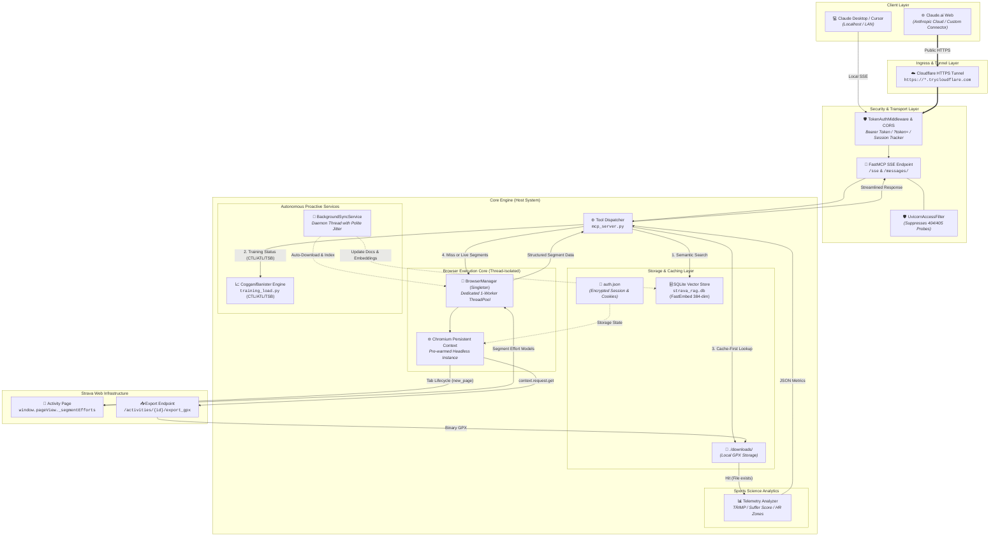
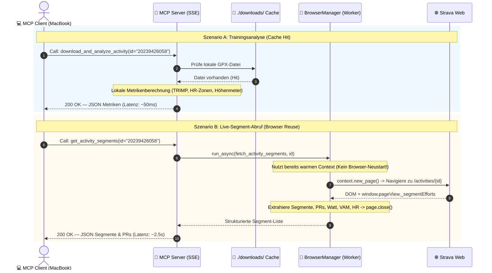

# System Architecture & Technical Specification

> **Strava GPX Sync — Headless MCP Integration & Performance Pipeline**  
> *Spezifikation der Systemarchitektur, Datenströme, Thread-Isolation und Caching-Strategien.*

---

## 1. High-Level Systemarchitektur

Das System agiert als lokale Netzwerk-Bridge zwischen KI-Clients (Claude Desktop, Cursor etc.) und Strava, ohne auf eine offizielle Strava API angewiesen zu sein.



---

## 2. Request-Lifecycle & Ablaufdiagramm

Das folgende Sequenzdiagramm illustriert die zwei zentralen Pfade: den **schnellen lokalen Cache-Pfad** und den **optimierten Browser-Pfad**.



---

## 3. Komponenten-Matrix

| Komponente | Datei / Modul | Primäre Verantwortung | Concurrency & Threading |
| :--- | :--- | :--- | :--- |
| **SSE Gateway** | [`mcp_server.py`](file:///C:/Users/han26/Documents/Coding_Projekte/strava-gpx-sync/mcp_server.py) | Bereitstellung des SSE-Transports, JSON-RPC Serialisierung, Host-Netzwerk-Exponierung (`0.0.0.0:8000`). | Asynchroner Event-Loop (Starlette / Uvicorn). |
| **Log Sentinel** | [`UvicornAccessFilter`](file:///C:/Users/han26/Documents/Coding_Projekte/strava-gpx-sync/mcp_server.py#L49-L90) | Filtert irrelevante HTTP-Statuscodes (`404 Not Found`, `405 Method Not Allowed`) aus dem Access-Log heraus. | Thread-safe Logging Filter. |
| **Browser Manager** | [`BrowserManager`](file:///C:/Users/han26/Documents/Coding_Projekte/strava-gpx-sync/mcp_server.py#L106-L230) | Globales Singleton zur Verwaltung des langlebigen Playwright-Browsers; Tab-Lifecycle-Management (`new_page` / `close`). | **Isoliert auf dediziertem 1-Worker-Thread** (`ThreadPoolExecutor`). |
| **Session Vault** | [`auth.json`](file:///C:/Users/han26/Documents/Coding_Projekte/strava-gpx-sync/auth.json) / [`config.py`](file:///C:/Users/han26/Documents/Coding_Projekte/strava-gpx-sync/config.py) | Persistenter Speicher für Google OAuth- und Strava-Session-Cookies via `storage_state`. | Dateibasiert, synchron geladen beim Context-Start. |
| **Segment Extractor**| [`sync_gpx.py`](file:///C:/Users/han26/Documents/Coding_Projekte/strava-gpx-sync/sync_gpx.py#L189-L380) | Liest Live-Segmente aus dem internen Strava Client-Model (`window.pageView._segmentEfforts`) mit DOM-Fallback aus. | Ausgeführt auf dem Browser-Worker-Thread. |
| **Analytics Core** | [`analyze_gpx.py`](file:///C:/Users/han26/Documents/Coding_Projekte/strava-gpx-sync/analyze_gpx.py) | Sportwissenschaftliche Auswertung: Haversine-Distanz, Höhenmeter-Filter, HR-Zonen und Banister-TRIMP (Suffer Score). | Reine CPU-Verarbeitung (Python Standardbibliothek). |
| **Vector RAG Store**| [`rag_engine.py`](file:///C:/Users/han26/Documents/Coding_Projekte/strava-gpx-sync/rag_engine.py) | Lokale SQLite-Vektor-Datenbank (`strava_rag.db`) mit FastEmbed ONNX-Embeddings (384 Dim) für kontextbezogene Ähnlichkeitssuchen. | Thread-sichere Verbindung mit Auto-Closing Context Managern. |
| **Training Load Engine** | [`training_load.py`](file:///C:/Users/han26/Documents/Coding_Projekte/strava-gpx-sync/training_load.py) | Sportwissenschaftliches Belastungsmodell nach Coggan/Banister: 42d CTL (Fitness), 7d ATL (Ermüdung), TSB (Form) & Fallback-TSS. | Reine deterministische Berechnung. |
| **Background Sync** | [`background_sync.py`](file:///C:/Users/han26/Documents/Coding_Projekte/strava-gpx-sync/background_sync.py) | Proaktiver Hintergrund-Worker mit Anti-Bot-Jitter und Delays für automatische Erkennung und Download neuer Touren. | Dedizierter Daemon-Thread mit unterbrechungsfreiem Sleep. |

---

## 4. Architekturentscheidungen (ADR)

### ADR-01: Dedizierter Single-Thread-Worker für Playwright
* **Kontext:** Playwrights Python-Synchronous-API basiert auf `greenlet`. Werden Playwright-Objekte zwischen unterschiedlichen Threads eines Pools gewechselt, stürzt die Anwendung mit `greenlet.error: cannot switch to a different thread` ab.
* **Entscheidung:** Der [`BrowserManager`](file:///C:/Users/han26/Documents/Coding_Projekte/strava-gpx-sync/mcp_server.py#L106) führt **alle** Browser-Interaktionen über einen einzigen, langlebigen Thread (`max_workers=1`) aus.
* **Ergebnis:** Vollständige Thread-Sicherheit bei asynchroner Anbindung an FastMCP via `loop.run_in_executor`.

### ADR-02: Singleton Context Reuse statt Prozess-Kaltstart
* **Kontext:** Das Starten einer Chromium-Instanz dauert auf Windows ca. 2.0 bis 3.5 Sekunden. Bei jedem Tool-Aufruf einen neuen Browser zu starten führt zu inakzeptabler Latenz.
* **Entscheidung:** Beim Server-Startup wird der Browser einmalig initialisiert (`ensure_initialized()`). Werkzeuge fordern lediglich kurzlebige Tabs an (`context.new_page()`) und schließen diese nach getaner Arbeit sofort wieder.
* **Ergebnis:** Reduzierung der Antwortzeiten für Folgeanfragen auf ~2.5s (begrenzt nur noch durch Stravas Seitenladezeit).

### ADR-03: Offline-First Caching (`./downloads/`)
* **Kontext:** Häufige Abfragen von Aktivitätsdaten belasten das Netzwerk und riskieren Bot-Verdacht oder Rate-Limits durch Strava.
* **Entscheidung:** Bereits heruntergeladene GPX-Dateien verbleiben dauerhaft im Ordner [`./downloads/`](file:///C:/Users/han26/Documents/Coding_Projekte/strava-gpx-sync/downloads/). Analysemethoden und Stream-Generatoren greifen primär auf diese lokalen Dateien zu.
* **Ergebnis:** Sub-100ms Antwortzeiten bei wiederholten Aktivitätsanalysen; null Netzwerktraffic zu Strava für bekannte Touren.

### ADR-04: Strikte Protokoll- & Stream-Trennung
* **Kontext:** MCP über SSE oder stdio reagiert empfindlich auf unreine Streams (z. B. versehentliche Status-Prints im Kommunikationskanal).
* **Entscheidung:** Sämtliche Logging-Ausgaben, Statusmeldungen und Uvicorn-Access-Logs werden ausnahmslos auf `sys.stderr` umgeleitet. Der [`UvicornAccessFilter`](file:///C:/Users/han26/Documents/Coding_Projekte/strava-gpx-sync/mcp_server.py#L49) tilgt unbedenkliche `404`/`405`-Probe-Logs.
* **Ergebnis:** Störungsfreie Datenübertragung und ein übersichtliches Server-Terminal.

### ADR-05: DOM-Paginierung & Host-seitiges In-Memory-Filtering
* **Kontext:** Strava rendert die Trainingsübersicht via dynamischem AJAX (`button.next_page`), URL-Query-Parameter werden serverseitig ignoriert. Zudem erzeugt das Zurückgeben ungefilterter Großmengen an Aktivitäten unnötigen LLM-Tokenverbrauch.
* **Entscheidung:** Der Browser traversiert über `button.next_page` sukzessive Trainingsseiten, bis genügend Rohdaten für das Ziel-Limit und die Ziel-Page vorhanden sind. Das Filtern nach Sportarten (mehrsprachige Alias-Tabelle) und Datumsbereichen (`after`/`before`) erfolgt schlank im Python-Arbeitsspeicher vor dem Slicing.
* **Ergebnis:** Minimale Token-Last für das MCP-Modell, flexible Zeitfenster- und Sportart-Filter, saubere Paginierungs-Metadaten (`total_matching`, `has_more`).

### ADR-06: Lokales Vektor-RAG via SQLite & FastEmbed ONNX
* **Kontext:** Eine semantische Suche über hunderte Aktivitäten soll ohne externe Cloud-Embeddings, API-Keys oder speicherintensive PyTorch-Installationen mit minimaler Latenz auf dem Host funktionieren.
* **Entscheidung:** Nutzung von FastEmbed mit dem kompakten Modell `BAAI/bge-small-en-v1.5` (~33MB ONNX). Die Embeddings (384 Dimensionen) werden als normalisierte Binär-BLOBs direkt in SQLite (`strava_rag.db`) persistiert. Die Kosinus-Ähnlichkeit wird per Vektormultiplikation in NumPy innerhalb von Sub-Millisekunden berechnet.
* **Ergebnis:** Völlig autarke, privatsphärefreundliche und blitzschnelle semantische Suche nach Profilen, Steigungen und Anstrengungen.

### ADR-07: Proaktiver Hintergrund-Sync mit Anti-Bot-Jitter
* **Kontext:** Manuelles Triggern vor Analysen erzeugt Wartezeiten; zu aggressives zyklisches Polling führt zu Strava-Bot-Sperren und Session-Abbrüchen.
* **Entscheidung:** Der [`BackgroundSyncService`](file:///C:/Users/han26/Documents/Coding_Projekte/strava-gpx-sync/background_sync.py) operiert in einem unabhängigen Daemon-Thread mit schonenden Intervallen (Standard: 45 Min), zufälligem Jitter (+/- 3 Min) und 2-4 Sekunden Pause zwischen Downloads. Bei Fehlern greift ein exponentielles Backoff.
* **Ergebnis:** Frische Daten im Cache ohne Kaltstarts und ohne Strava-Sperrrisiko.

### ADR-08: Mathematische Belastungskontinuität & Fallback-TSS
* **Kontext:** Die Coggan/Banister-Modelle (CTL/ATL/TSB) basieren auf kontinuierlichen Exponentialdurchschnitten. Fehlt bei Aktivitäten die Herzfrequenzmessung (kein HR-Gurt getragen), würde ein Auslassen die Formkurve künstlich einbrechen lassen.
* **Entscheidung:** Einheiten mit Herzfrequenz nutzen den Suffer Score / HRSS; für Einheiten ohne HF greift eine deterministische sportwissenschaftliche Fallback-Berechnung aus Dauer, Höhenmetern (Hubarbeit $W=mgh$), Tempo und Sportart.
* **Ergebnis:** Mathematisch lückenlose, belastbare Fitness- und Ermüdungskurven über die gesamte Trainingshistorie.

---

## 5. Lifecycle & Fehlerbehandlung

```text
[ Server Start ]
       │
       ▼
[ setup_uvicorn_logging_filter() ] ──► Unterdrückt 404/405 Rauschen
       │
       ▼
[ BrowserManager.ensure_initialized() ] ──► Chromium startet im Hintergrund (Headless)
       │
       ▼
[ SSE Server Listening on 0.0.0.0:8000 ]
       │
   ┌───┴────────────────────────────────────────┐
   │ Event Loop                                 │
   │  ├── Tool Call -> Worker Thread Execution  │
   │  │    ├── Browser alive? -> Weiter         │
   │  │    └── Browser disconnected? -> Neustart│
   │  └── Session abgelaufen? -> Saubere JSON-  │
   │                             Fehlermeldung  │
   └───┬────────────────────────────────────────┘
       │
       ▼ (SIGINT / Shutdown)
[ BrowserManager.close() ] ──► Tabs schließen ──► Context schließen ──► Chromium beenden
```
