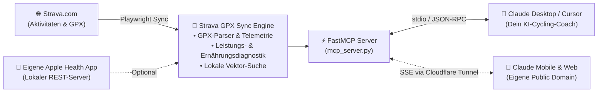

# 🚴‍♂️ Strava GPX Sync & AI Cycling Coach (MCP Server)

[](https://www.python.org/)
[](https://modelcontextprotocol.io/)
[](https://github.com/Hannes-frbg/strava-gpx-sync/actions)
[](https://www.strava.com/)
[](https://playwright.dev/)
[](LICENSE)

Verbinde Strava direkt mit **Claude Desktop**, **Cursor**, der **Claude Mobile App** oder jedem anderen **MCP-Client** und mach deine KI zu deinem persönlichen Radsport-Coach!

**Strava GPX Sync** ist ein leichtgewichtiger, lokaler **Model Context Protocol (MCP) Server**. Er lädt deine Fahrten automatisch via Browser-Automatisierung von Strava herunter, berechnet echte Leistungsmetriken (Virtual Power, VAM, TRIMP, Kohlenhydrat- und Flüssigkeitsverbrauch) und stellt sie deiner KI per MCP-Tools zur Verfügung.

Kein teurer Strava-Entwickler-Account, kein App-Review, keine Cloud-Abhängigkeit: Alles läuft direkt auf deinem eigenen Rechner.

---

## 🗺️ Live-Demo: 100 km Gravel-Tour

Im Ordner [`demo/`](demo/) liegt eine echte 100-km-Gravel-Tour zum Ausprobieren:
- **GPX-Datei:** [`demo/demo_100km_ride.gpx`](demo/demo_100km_ride.gpx) (102 km, 415 hm)
- **Interaktive Karte:** Öffne [`demo/demo_100km_map.html`](demo/demo_100km_map.html) einfach mit einem Doppelklick in deinem Browser. Du siehst sofort die GPS-Strecke auf einer interaktiven Karte mit Höhenprofil, Leistungs- und Ernährungsdaten!

```text
==============================================================================
  AKTIVITÄTS-ANALYSE: Meine ersten 100km (Demo)
  Strecke: 101.96 km | Höhenmeter: +415 hm | Netto-Fahrzeit: 04:54:11
==============================================================================
  • Ø Geschwindigkeit: 20.8 km/h (Max: 41.2 km/h)
  • Virtual Power: 67.3 W Ø (170.8 W am Berg / 2.85 W/kg)
  • Kletterleistung (VAM): 650 m/h (Solides Grundlagenausdauer-Klettern)
  • Energieverbrauch: 1,315 kcal (160 g Kohlenhydrate verbrannt)
  • Schweißverlust: ca. 3.6 Liter (ca. 0.74 L/h)
==============================================================================
```

---

## ⚡ Was kann der MCP-Server?

Wenn der Server läuft, kannst du in Claude Desktop einfach ganz normal Fragen stellen:

> **Du:** *"Claude, schau dir meine letzte Ausfahrt an. Wie war mein Pacing am Berg?"*  
> **Claude:** Ruft das Tool `download_and_analyze_activity` auf, liest die Steigungssegmente aus und erklärt dir genau, bei welchem Kilometer du überpaced hast.

> **Du:** *"Wie steht es aktuell um meine Fitness und Ermüdung?"*  
> **Claude:** Ruft `get_training_status` auf und berechnet dir deine CTL (Fitness), ATL (Ermüdung) und TSB (Form) nach dem Banister-Modell.

> **Du:** *"Ich fahre morgen eine harte 90-km-Runde. Wie viele Kohlenhydrate muss ich einpacken?"*  
> **Claude:** Berechnet mit `calculate_live_bonk_and_fueling_horizon` deinen voraussichtlichen Verbrauch und gibt dir eine Empfehlung für Riegel und Isodrinks.

---

## 🏗️ Reine, lokale MCP-Architektur

Einfach, schnell und ohne unnötigen Ballast:



- **Keine externen Cloud-Modelle nötig:** Der MCP-Server läuft lokal und spricht direkt mit deinem lokalen Claude Desktop oder Cursor.
- **Wissenschaftliche Formeln:** Virtual Power nach Fahrergewicht und Steigung, VAM-Kletterrate, Herzfrequenz-Zonen und Glykogenspeicher-Prognose (nach Jeukendrup & Romijn).

---

## 🚀 In 3 Schritten startklar

### 1. Repository klonen & vorbereiten

```bash
git clone https://github.com/Hannes-frbg/strava-gpx-sync.git
cd strava-gpx-sync

# Virtuelle Umgebung erstellen
python -m venv .venv

# Aktivieren (Windows PowerShell):
.\.venv\Scripts\Activate.ps1
# Aktivieren (Linux/macOS):
# source .venv/bin/activate

# Abhängigkeiten installieren
pip install -r requirements.txt
playwright install chromium
```

### 2. Strava-Login (Einmalig)

```bash
python setup_auth.py
```
Ein Chrome-Fenster öffnet sich. Logge dich ganz normal bei Strava ein (auch "Mit Google anmelden" oder 2FA funktioniert problemlos). Sobald du dein Strava-Dashboard siehst, speichert das Tool deine Session und schließt sich wieder.

### 3. In Claude Desktop eintragen

Öffne deine Claude Desktop Konfiguration:
- **Windows:** `%APPDATA%\Claude\claude_desktop_config.json`
- **macOS:** `~/Library/Application Support/Claude/claude_desktop_config.json`

Füge unter `mcpServers` folgendes hinzu (Pfade zu deinem Python und Skript anpassen):

```json
{
  "mcpServers": {
    "strava-coach": {
      "command": "C:\\Pfad\\zu\\strava-gpx-sync\\.venv\\Scripts\\python.exe",
      "args": [
        "C:\\Pfad\\zu\\strava-gpx-sync\\mcp_server.py"
      ]
    }
  }
}
```

Starte Claude Desktop neu: Fertig! Du hast ab sofort Zugriff auf alle Strava-Tools.

---

## 🍏 Apple Health Integration: Offene Schnittstelle für eigene iOS-Apps

Der MCP-Server bringt mit `apple_health_service.py` bereits eine vorbereitete, passive Schnittstelle für Gesundheits- und Erholungsdaten mit (Ruhepuls, Schlafphasen, HRV, Readiness-Score):

- **Wie es funktioniert:** Der Server führt im Hintergrund extrem ressourcenschonende Mikro-Pings (<0.35s Timeout) im lokalen Netzwerk aus. Sobald auf einem iPhone im gleichen WLAN ein lokaler Health-REST-Dienst auf Port 8080 aktiv ist, werden die Vitaldaten in 1 bis 5 Sekunden automatisch synchronisiert.
- **Eigene Apps & Kurzbefehle:** Die Schnittstelle ist komplett offen. Jeder kann eine eigene kleine iOS-App oder einen Apple Shortcut bauen, der einfache Endpunkte wie `/api/vitals`, `/api/sleep` oder `/api/export` bereitstellt.
- **Ausblick:** In Zukunft ist ein eigenes GitHub-Repository mit einer fertigen, nativen iOS-Begleit-App in Planung, die man sich einfach aufs iPhone lädt und die den Datenabgleich auf Knopfdruck startet.

---

## 🌐 Unterwegs & Mobile nutzen: Public Domain via Cloudflare Tunnel

Lokal läuft der Server standardmäßig über stdio oder localhost. Wer den KI-Coach aber auch unterwegs in der **Claude Mobile App auf dem Smartphone** oder auf **claude.ai im Browser** nutzen möchte, kann den MCP-Server über einen kostenlosen **Cloudflare Zero Trust Tunnel** mit einer eigenen Public Domain verbinden:

1. **Tunnel starten:**
   ```bash
   cloudflared tunnel --url http://localhost:8000
   ```
   *(Oder über einen festen Cloudflare Tunnel auf deine eigene Subdomain wie `mcp.deine-domain.de`)*

2. **Absicherung:**
   Setze in deiner `.env`-Datei einen sicheren Token:
   ```env
   MCP_AUTH_TOKEN=dein_geheimes_passwort_token
   ```

3. **In Claude.ai eintragen:**
   Füge die URL `https://mcp.deine-domain.de/sse` mit dem Header `Authorization: Bearer <TOKEN>` in Claude.ai unter benutzerdefinierten Konnektoren ein. Schon hast du deinen Strava-Coach immer in der Hosentasche dabei!

---

## 🔒 Wichtiger Hinweis zu Sicherheit & Cookies

Damit der automatische GPX-Download ohne offiziellen Strava API-Key funktioniert, nutzt das Tool Browser-Automatisierung mit Playwright:

- Nach dem Login über `setup_auth.py` werden deine Session-Cookies in der lokalen Datei **`auth.json`** gespeichert.
- **Wichtig:** Diese Cookies stehen im Klartext in dieser JSON-Datei auf deiner Festplatte.
- **Schutz:** Die Datei `auth.json` und der Ordner `downloads/` sind fest in der [`.gitignore`](.gitignore) eingetragen. Sie werden **niemals** auf GitHub hochgeladen und verlassen deinen Computer zu keinem Zeitpunkt.
- Gib die Datei `auth.json` niemals an Dritte weiter, da sie deine Strava-Sitzung enthält.

---

## 🛠️ Wichtigste MCP-Tools im Überblick

| Tool | Was es macht |
| :--- | :--- |
| `list_strava_activities` | Zeigt deine neuesten Strava-Aktivitäten mit Distanz, Zeit und Typ an |
| `download_and_analyze_activity` | Lädt eine Fahrt herunter und berechnet Watt, VAM, Kletterleistung und Ernährung |
| `analyze_local_gpx` | Wertet eine beliebige lokale GPX-Datei aus (z.B. aus dem `demo/`-Ordner) |
| `get_training_status` | Ermittelt deinen aktuellen Form- und Ermüdungszustand (CTL, ATL, TSB) |
| `calculate_live_bonk_and_fueling_horizon` | Warnt vor dem gefürchteten Hungerast und berechnet Kohlenhydratmengen |
| `calculate_activity_decoupling` | Erkennt kardiale Drift (Entkopplung von Puls und Watt bei Ermüdung) |
| `search_activities_rag` | Durchsucht deine vergangenen Fahrten mit normaler Sprache per Vektorsuche |

---

## 🧪 Tests

Das Projekt enthält eine vollständige Test-Suite mit 81 automatisierten Tests:

```bash
python -m unittest test_mcp_server.py
```
*(Alle 81 Tests laufen lokal durch: `Ran 81 tests ... OK`)*

---

## 📄 Lizenz

Open Source unter der [MIT-Lizenz](LICENSE).  
Gebaut von [Hannes-frbg](https://github.com/Hannes-frbg). Feedback, Ideen und Pull Requests sind jederzeit willkommen!
