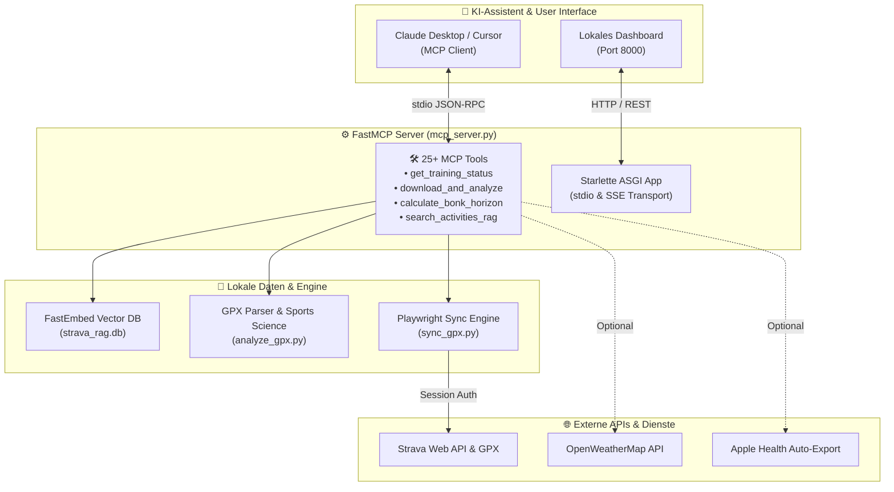

# 🚴‍♂️ Strava GPX Sync & AI Cycling Coach (MCP Server)

[](https://www.python.org/)
[](https://modelcontextprotocol.io/)
[](https://www.strava.com/)
[](https://playwright.dev/)
[](https://github.com/qdrant/fastembed)
[](LICENSE)

Verwandle **Claude Desktop**, **Cursor** oder jeden **MCP-fähigen KI-Client** in deinen persönlichen, datenschutzfreundlichen **KI-Radsport-Trainer**! 

**Strava GPX Sync** synchronisiert deine Aktivitäten vollautomatisch von Strava, berechnet wissenschaftliche Leistungsmetriken (Virtual Power, VAM, TRIMP, aerobe Entkopplung, Kohlenhydrat- & Flüssigkeitsbedarf) und stellt deiner KI über das offizielle **Model Context Protocol (MCP)** alle Daten in Echtzeit zur Verfügung.

> 🔒 **100 % Lokal & Privat:** Alle GPX-Dateien, Vektordatenbanken und Berechnungen verbleiben vollständig auf deinem Rechner. Keine Weitergabe an Cloud-Server oder Drittanbieter.

---

## 🗺️ Interaktive Demo (100 km Gravel-Tour)

Im Ordner [`demo/`](demo/) findest du eine aufbereitete 100-km-Gravel-Ausfahrt mit vollständigen Telemetrie- und Leistungsdaten:
- 📄 **GPX-Datei:** [`demo/demo_100km_ride.gpx`](demo/demo_100km_ride.gpx) (102.8 km, 421 hm)
- 🗺️ **Interaktive Karte:** Öffne [`demo/demo_100km_map.html`](demo/demo_100km_map.html) direkt in deinem Browser für eine interaktive Leaflet-Kartenvisualisierung mit Dark-Mode und Live-Statistiken!

```
==============================================================================
  AKTIVITÄTS-ANALYSE: Meine ersten 100km (Demo)
  Strecke: 101.96 km | Höhenmeter: +414.9 hm | Netto-Fahrzeit: 04:54:11
==============================================================================
  • Ø Geschwindigkeit: 20.80 km/h (Max: 41.17 km/h)
  • Virtual Power: 67.3 W Ø (170.8 W am Berg / 2.85 W/kg)
  • Kletterleistung (VAM): 650 m/h (U17 Solides Grundlagenausdauer-Klettern)
  • Energieverbrauch: 1,315 kcal (160.4 g Kohlenhydrate verbrannt)
  • Schweißverlust & Hydration: 3.63 Liter (ca. 0.74 L/h)
==============================================================================
```

---

## ✨ Features & Highlights

### 🤖 1. KI-Cycling-Coach via MCP
- Sprich in **Claude Desktop** oder **Cursor** ganz natürlich mit deiner KI:
  - *„Claude, analysiere meine gestrige Ausfahrt. War meine Pacing-Strategie an den Anstiegen optimal?“*
  - *„Wie steht es um mein Training Load (CTL/ATL/TSB) diese Woche? Sollte ich morgen Intervalle fahren oder Pause machen?“*
  - *„Berechne mir basierend auf der 100km-Route den genauen Kohlenhydratbedarf pro Stunde.“*

### ⚡ 2. Robuster Playwright Strava-Sync
- Überwindet Cloudflare- und Bot-Protection durch persistente Browser-Sessions (`auth.json`).
- Unterstützt manuelle Google OAuth / 2FA Authentifizierung mit einem einzigen Befehl (`python setup_auth.py`).

### 🧬 3. Sportwissenschaftliche Leistungsdiagnostik
- **Leistung & Watt:** Virtual Power Schätzung basierend auf GPS, Gefälle, Rollwiderstand (OSM-Wegeoberflächen) und Systemgewicht.
- **Kletterleistung:** Steigrate (VAM in m/h) und W/kg-Klassifikation nach Ausbildungsrichtlinien.
- **Aerobe Entkopplung (Cardiac Drift):** Vergleicht die Effizienz-Ratio der ersten und zweiten Fahrthälfte zur Erkennung von Ermüdung.
- **Ernährungs- & Stoffwechselberechnung:** Berechnet Fett- und Kohlenhydrat-Oxidationsraten nach Jeukendrup & Romijn, ermittelt das Hungerast-Risiko und empfiehlt die stündliche Zufuhr (g/h).

### 🔍 4. Lokale RAG-Engine (FastEmbed + SQLite)
- Durchsucht deine gesamte Fahrthistorie semantisch in Sekunden (*„Finde alle Fahrten mit mehr als 80 km und über 25 km/h Schnitt“*).

### 🍏 5. Optionale Apple Health & Wetter-Integration
- Liest auf Wunsch Ruhepuls, Schlafqualität und HRV (Herzfrequenzvariabilität) für ganzheitliche Erholungs-Scores ein.
- Berechnet segmentgenaue Gegenwind- und Rückenwind-Effekte über OpenWeatherMap.

---

## 🏗️ System-Architektur



---

## 🚀 Schnelleinstieg

### 1. Repository klonen & Abhängigkeiten installieren

```bash
git clone https://github.com/Hannes-frbg/strava-gpx-sync.git
cd strava-gpx-sync

# Virtuelle Umgebung erstellen
python -m venv .venv
# Unter Windows:
.venv\Scripts\activate
# Unter Linux/macOS:
# source .venv/bin/activate

# Abhängigkeiten installieren
pip install -r requirements.txt
playwright install chromium
```

### 2. Einmalige Strava-Authentifizierung

Starte den Browser-Login:
```bash
python setup_auth.py
```
Ein Chrome-Fenster öffnet sich. Logge dich ganz normal bei Strava ein (auch mit Google oder 2FA möglich). Sobald du dein Strava-Dashboard siehst, speichert das Skript die Session sicher in `auth.json` ab und schließt das Fenster.

### 3. MCP Server in Claude Desktop einbinden

Öffne deine Claude Desktop Konfigurationsdatei:
- **Windows:** `%APPDATA%\Claude\claude_desktop_config.json`
- **macOS:** `~/Library/Application Support/Claude/claude_desktop_config.json`

Füge folgenden Eintrag unter `mcpServers` hinzu (Pfade anpassen):

```json
{
  "mcpServers": {
    "strava-coach": {
      "command": "C:\\Users\\DEIN_BENUTZERNAME\\...\\strava-gpx-sync\\.venv\\Scripts\\python.exe",
      "args": [
        "C:\\Users\\DEIN_BENUTZERNAME\\...\\strava-gpx-sync\\mcp_server.py"
      ]
    }
  }
}
```

Starte Claude Desktop neu. Du siehst nun das 🔨-Symbol mit allen Strava-Tools!

---

## 🛠️ Ausgewählte MCP-Werkzeuge

| Tool | Beschreibung |
| :--- | :--- |
| `list_strava_activities` | Ruft deine neuesten Aktivitäten direkt live von Strava ab |
| `download_and_analyze_activity` | Lädt eine Aktivität herunter und führt eine vollständige sportwissenschaftliche Auswertung durch |
| `analyze_local_gpx` | Analysiert beliebige lokale GPX-Dateien |
| `get_training_status` | Berechnet CTL (Fitness), ATL (Fatigue) und TSB (Form) nach dem Banister-Impulse-Response-Modell |
| `calculate_live_bonk_and_fueling_horizon` | Prognostiziert Glykogenspeicher und warnt vor dem Hungerast |
| `calculate_activity_decoupling` | Berechnet die aerobe Entkopplung (Pwr:HR Ratio Drift) |
| `search_activities_rag` | Durchsucht deine Fahrthistorie mit natürlicher Sprache (semantische Vektorsuche) |
| `get_council_coaching_verdict` | Multi-Agenten Feedback von Virtuellen Trainern für gezielte Renntaktik |

---

## 🧪 Tests ausführen

Das Projekt verfügt über eine umfassende Test-Suite (81 Unit- und Integrationstests):

```bash
python -m unittest test_mcp_server.py
```

Ergebnis: `Ran 81 tests ... OK`

---

## 🛡️ Datenschutz & Sicherheit

- **Keine Passwörter im Klartext:** Zugangsdaten werden niemals im Quellcode gespeichert.
- **Private Routen geschützt:** Der Ordner `downloads/` ist standardmäßig in `.gitignore` eingetragen, damit deine privaten Trainingsrunden und Start-/Zielorte niemals versehentlich auf GitHub landen.
- **Demodaten anonymisiert:** Die Demo-GPX-Datei wurde mit einer Sicherheits-Schutzzone versehen.

---

## 📄 Lizenz & Danksagung

Dieses Projekt ist unter der **MIT-Lizenz** lizenziert – frei zur Nutzung, Weiterentwicklung und Anpassung für deine eigenen Radsport-Projekte!

*Erstellt von [Hannes-frbg](https://github.com/Hannes-frbg) — Feedback, PRs und Sterne auf GitHub sind herzlich willkommen!*
